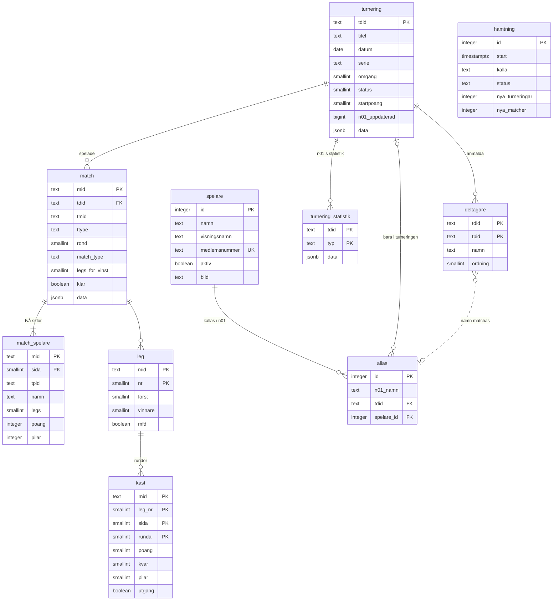
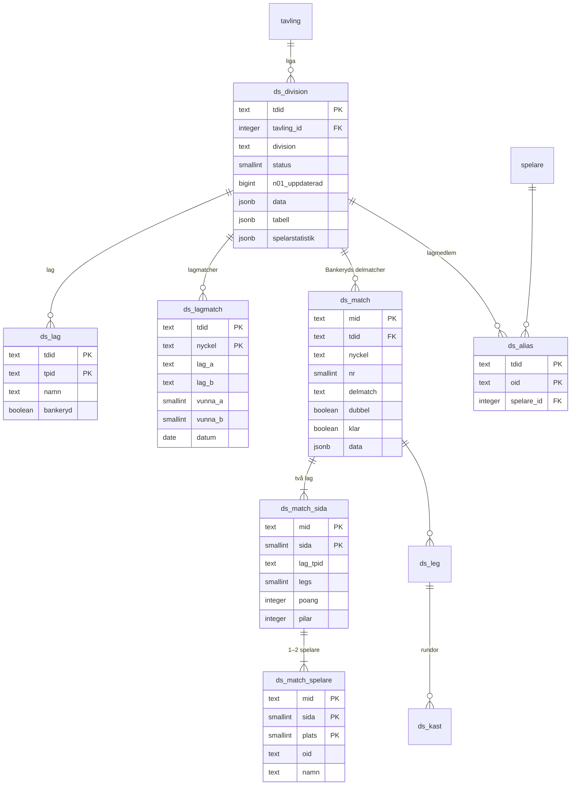

# Datamodell – bdc-statistik

Supabase-projektet `bdc-statistik`, schemat `public`. Original här i repot; kopia i Obsidian (`Dart-klubbdatabas - Datamodell`).

## Distriktsserien (v0.5)
Egna tabeller (`ds_*`), så att klubbens turneringar, spelarlista och cuper inte påverkas. En liga följs via en `tavling` med typ *distriktsserie* och `n01_lgid`.

- **Urval (beslut Henrik 2026-10-31):** alla divisioner i ligan med serietabell (`tabell` = n01:s standings) och alla lagmatchresultat (`lg_result`); delmatcher, legs, rundor och spelarstatistik (`player_stats_list`) bara för lag med *Bankeryd* i namnet.
- **Lagmatch:** nyckeln är n01:s `<grupp>_<id>` ur `tmid` (`<tdid>_lg_0_xpj5_<lag>_<lag>`); `vunna_a/b` = vunna singlar + dubblar. 18 delmatcher per lagmatch: 16 singlar och 2 dubblar.
- **Lagmedlemmar:** `oid` gäller i hela divisionen. Kopplas till `spelare` via `ds_alias` (admin), annars samma fullständiga namn (om entydigt), annars ett allmänt `alias`.
- **Pågående:** divisionerna har status 30 (pågår) hela säsongen; hämtningen jämför `updateTime` och hämtar om ändrade divisioner och delmatcher.
- **Kontroll 2026-10-31:** singlar + dubblar ur delmatcherna stämmer med n01:s `set`/`winSet` för alla 11 spelare i Bankeryd A och B.

## Regler
- **Källa:** n01:s API, alla turneringar med *Bankeryd* i titeln. Importen skriver med service role; rådata sparas i `data` (jsonb).
- **Spelaridentitet:** n01 har inget spelar-ID mellan turneringar. `alias` kopplar ett n01-namn (skiftlägesokänsligt) till en `spelare` – allmänt (`tdid` tom) eller bara i en turnering (`tdid` satt, går före det allmänna).
- **match_spelare** har ingen främmande nyckel till `deltagare` – n01 kan ha matcher med namn utanför anmälningslistan.
- **kast:** en rad per runda i 01-legs; startraden sparas inte. Vid utgång är `poang` det som var kvar och `pilar` 1–3. Cricket finns bara i rådata.
- **Middle for diddle:** legs avgjorda med närmast bull (`leg.mfd`, vanligt när rundtaket nås) **räknas med** i poäng och pilar – så gör n01 i både matchdata och turneringsstatistik (kontrollerat 2026-10-31: 4 245 av 4 246 matchsidor stämmer mot `allScore`/`allDarts`, 967 av 968 deltagare mot n01:s `stats_list`).
- **Bästa leg och pilar per leg** räknar bara legs vunna med pilar; n01 räknar även legs avgjorda med middle for diddle (+1 pil). 100+/140+/170+/180 och högsta utgång stämmer exakt med n01 (kontrollerat 2026-10-31, 967 av 967).
- **Handikapp:** en sida kan starta på annan poäng än matchens `startpoang` (t.ex. 401 mot 301) – första raden i n01:s `playerData` visar startpoängen.
- **Hämtning:** Edge Function `hamta` (`supabase/functions/hamta`) – se `03_hamtning_schema.sql` för schemat (pg_cron tor och sön 23:00 svensk tid) och nyckeln i Vault.
- **Spelare:** `fornamn` + `efternamn`; `namn` sätts av en trigger när någon av dem finns. `medlemsnummer` unikt, tomt = null.
- **Ändringslogg:** `alias_logg` fylls av en trigger vid varje ny, flyttad eller borttagen koppling, och av `sla_ihop_spelare(fran, till)` (bara admin) som flyttar alla kopplingar och tar bort den ena spelaren.
- **Cuper:** `tavling` (namn, typ klubbcup/distriktsserie, serie, från, till, kvalgräns, poängregler i `regler` jsonb), `tavling_val` (undantag per turnering: final, omgang, utesluten), `poang_manuell` (bull-utgångar). Placering 1 = finalvinst, 2 = finalförlust, 3 = semifinalplats (n01:s rank).
- **Porträtt (v0.7.0):** bilden ligger i den privata Storage-bucketen `portratt` som `<spelare_id>.jpg` (256×256 JPEG, förminskad i webbläsaren). `spelare.bild` = filnamnet med versionsstämpel (`47.jpg?v=…`), null = ingen bild. Alla inloggade får lägga upp, byta och ta bort (beslut Henrik 2026-11-01) – bilden sätts via `satt_bild(sid, bild)`, som bara ändrar den kolumnen. Appen visar bilderna via signerade länkar som gäller en timme.
- **Spelform:** turneringens `startpoang` – 501 (torsdagar) eller 301 (söndagar, sedan 2026-06-28 med handikapp 301–421 per spelare; den egna startpoängen syns i första rundan i `kast`). Appen delar statistiken per spelform (beslut Henrik 2026-11-01).
- **Behörighet:** roll i `app_metadata.roll`. `medlem` och `admin` läser allt; bara `admin` skriver `spelare` och `alias`. Anonyma har ingen åtkomst.

## Vyer
| Vy | Innehåll |
| --- | --- |
| `v_deltagare` | Deltagare med kopplad `spelare_id` (turneringsspecifikt alias före allmänt) |
| `v_turnering_statistik` | n01:s statistik per spelare och turnering ur `stats_list`: placering, matcher, legs, snitt, first 9, 100+/140+/170+/180, high out, bästa/sämsta leg |
| `v_turnering` | Turneringslistan: serie, omgång, antal deltagare och matcher, vinnare, länk till n01 |
| `v_match` | En rad per match med båda sidorna: legs, snitt, kopplad spelare |
| `v_spelare_match` | En rad per match och spelare: motståndare, legs, snitt, first 9, pilar per vunnet leg, bästa leg, högsta runda och utgång, 100+/140+/170+/180 – spelarsidans grafer, rekord och matchsidan |
| `v_namn_underlag` | Ett n01-namn per turnering: datum, serie, snitt, placering, koppling per turnering och allmänt – adminsidans underlag för att koppla namn |
| `v_tavling_turnering` | En cups turneringar: regeln (serie + datum) plus tillagda, minus uteslutna; roll omgång eller final |
| `v_cup_rad` | Per cup, omgång och deltagare: placering, vunna matcher, 180, 171, hög utgång (≥ cupens gräns), kortset (≤ cupens pilar) |
| `v_cup_poang` | Poängtabellen per cup och person med cupens poängregler, inklusive inmatade bull-utgångar |
| `intern.match_kast` | Materialiserad vy (schemat `intern`, inte i API:et): rundorna summerade per match och sida. Räknas om av `public.uppdatera_statistik()` när hämtningen fått nya matcher |
| `v_ds_tabell` | Distriktsserien: serietabell per division (placering, spelade, V/O/F, +/−, poäng), Bankeryds lag markerade |
| `v_ds_lagmatch` | Distriktsserien: lagmatcher med lagnamn, resultat och antal hämtade delmatcher |
| `v_ds_spelare` | Distriktsserien: Bankeryds lagmedlemmar med n01:s statistik och kopplad spelare, singlar och dubblar vunna–spelade |
| `v_ds_match` | Distriktsserien: delmatcher med båda lagen, legs, snitt och spelarna (jsonb) |

Vyerna har `security_invoker = true` (följer tabellernas RLS) och är skrivskyddade.
