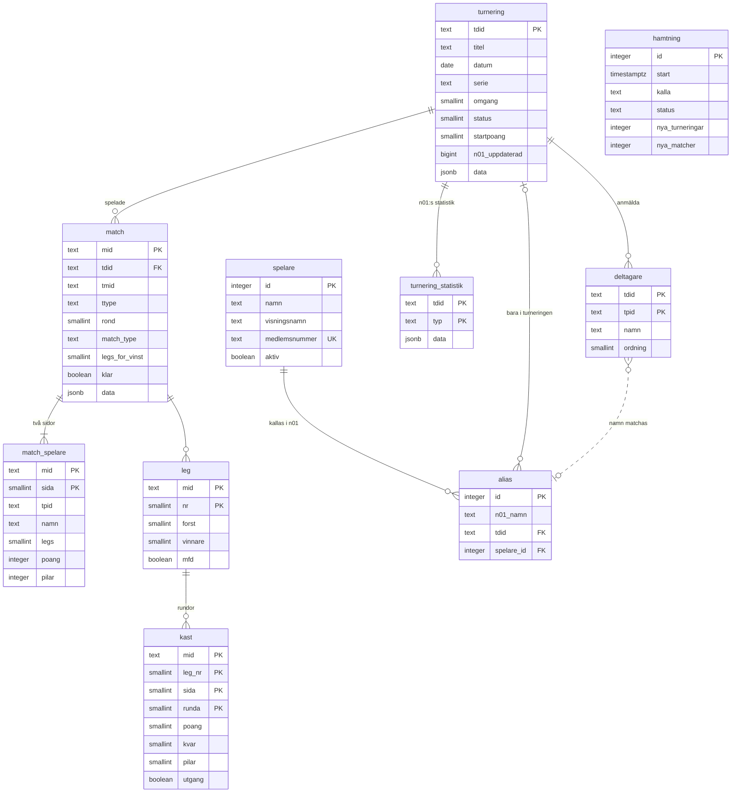

# Datamodell – bdc-statistik

Supabase-projektet `bdc-statistik`, schemat `public`. Original här i repot; kopia i Obsidian (`Dart-klubbdatabas - Datamodell`).

## Regler
- **Källa:** n01:s API, bara turneringar med *Bankeryd Dart Club* i titeln. Importen skriver med service role; rådata sparas i `data` (jsonb).
- **Spelaridentitet:** n01 har inget spelar-ID mellan turneringar. `alias` kopplar ett n01-namn (skiftlägesokänsligt) till en `spelare` – allmänt (`tdid` tom) eller bara i en turnering (`tdid` satt, går före det allmänna).
- **match_spelare** har ingen främmande nyckel till `deltagare` – n01 kan ha matcher med namn utanför anmälningslistan.
- **kast:** en rad per runda i 01-legs; startraden sparas inte. Vid utgång är `poang` det som var kvar och `pilar` 1–3. Cricket finns bara i rådata.
- **Behörighet:** roll i `app_metadata.roll`. `medlem` och `admin` läser allt; bara `admin` skriver `spelare` och `alias`. Anonyma har ingen åtkomst.

## Vyer
| Vy | Innehåll |
| --- | --- |
| `v_deltagare` | Deltagare med kopplad `spelare_id` (turneringsspecifikt alias före allmänt) |
